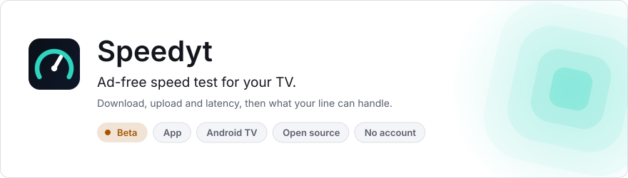
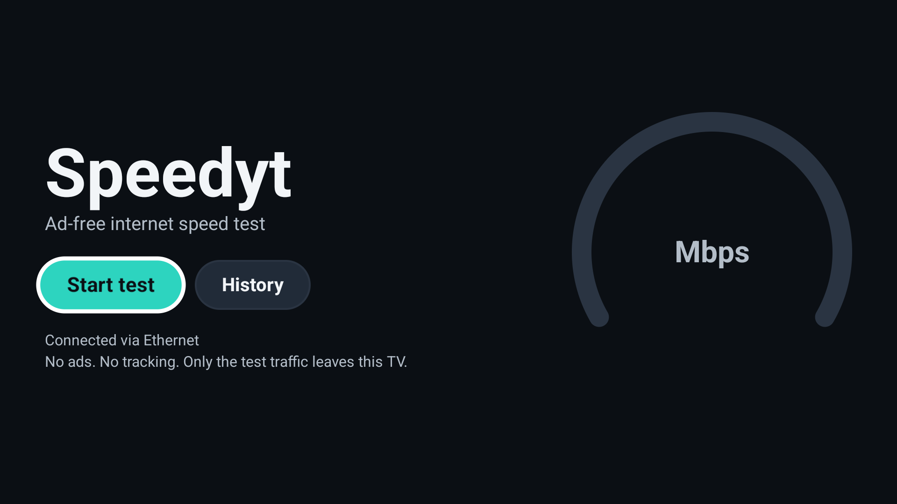
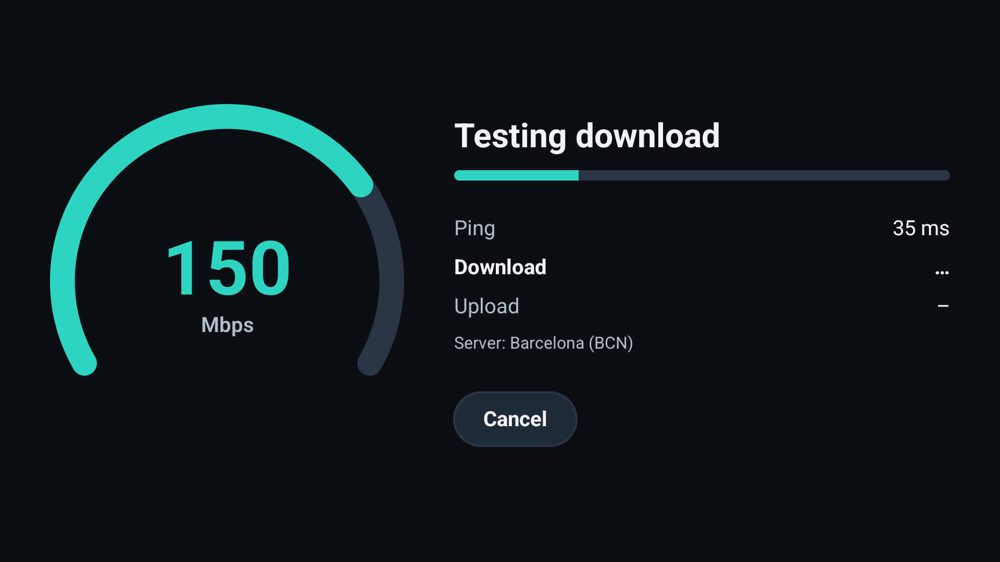
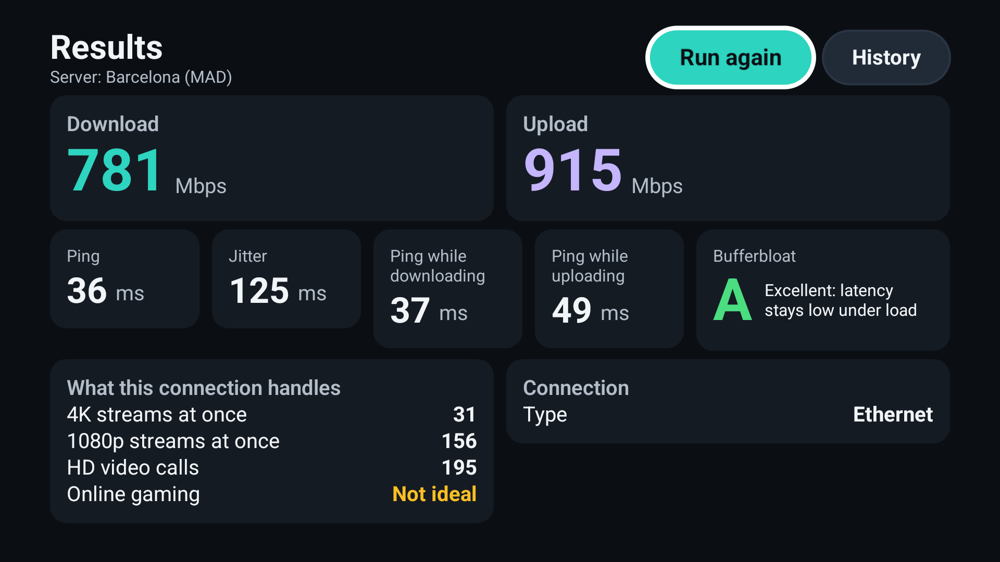
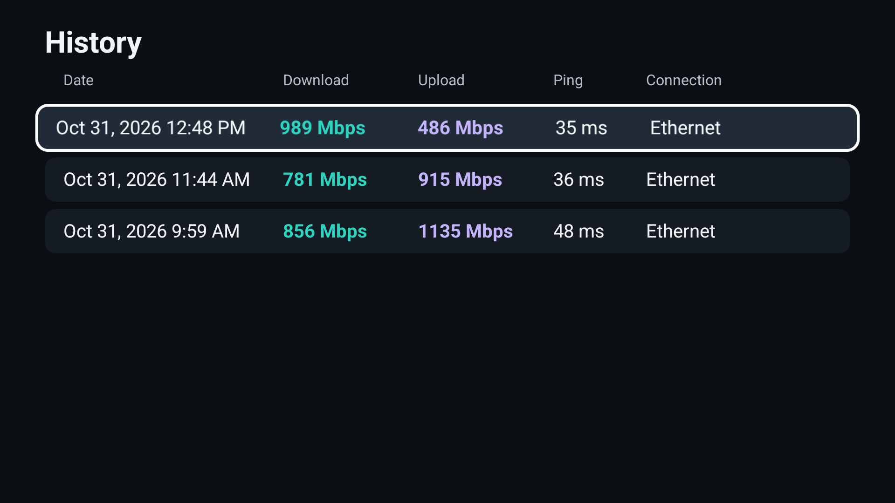
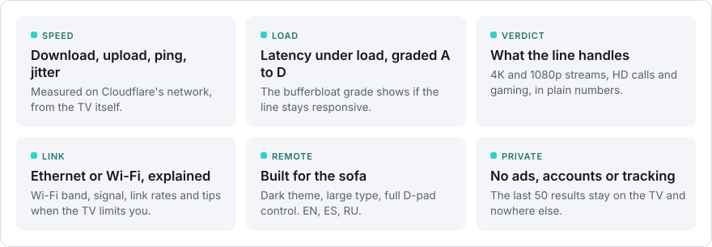
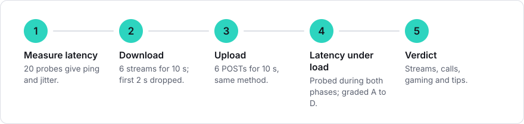

<!-- Pictures: docs/readme/spec.json, drawn by readme-kit. Do not edit the SVGs by hand. -->
<picture><source media="(prefers-color-scheme: dark)" srcset="docs/readme/hero-dark.svg"></picture>

**Press one button and see what your TV's connection really delivers, in plain words.**
Speedyt runs on Android TV and Google TV, measures from the TV itself and says how many 4K streams, HD calls and games the line can carry.
It is in beta, MIT-licensed, in English, Spanish and Russian.

[Privacy](docs/privacy.md) · [Play Store notes](docs/PLAY-STORE.md) · [Landing page source](docs/index.md)

<p align="center">




</p>

## What it does

<picture><source media="(prefers-color-scheme: dark)" srcset="docs/readme/highlights-dark.svg"></picture>

- **Tips only when they apply.** Switch to 5 GHz, move the router, or a note that many TVs have a 100 Mbps Ethernet port.
- **Server shown by data-centre.** For example "Server: Madrid (MAD)".

## How it works

<picture><source media="(prefers-color-scheme: dark)" srcset="docs/readme/steps-dark.svg"></picture>

## Quick start

```sh
git clone https://github.com/zaitsew/speedyt && cd speedyt
echo "sdk.dir=$HOME/Library/Android/sdk" > local.properties   # your Android SDK path
./gradlew :app:assembleDebug                                   # needs JDK 17 or newer
adb connect <tv-ip>:5555                                       # TV: Settings > Developer options > Network debugging
adb install -r app/build/outputs/apk/debug/app-debug.apk       # then open Speedyt from the TV launcher
```

## How it measures

The test talks to Cloudflare's public speed-test endpoints,
`GET https://speed.cloudflare.com/__down?bytes=N` and `POST .../__up`.

| Stage | What happens |
|---|---|
| Idle latency | 1 warm-up request (opens the connection, not counted), then 20 requests of `__down?bytes=0`. Time from sending the request to the first response byte. Reported: median (ping) and jitter, the mean absolute difference of consecutive samples. |
| Download | 6 parallel HTTP/1.1 connections stream 50 MB requests for 10 s. Bytes are counted as they arrive and sampled 4 times a second. The first 2 s are dropped as warm-up; the result is the rate over the remaining 8 s. |
| Upload | The same, with 6 parallel POSTs of 25 MB of random bytes for 10 s. |
| Loaded latency | While download runs, and again while upload runs, a separate connection keeps probing latency about 5 times a second. Probes in the warm-up window are dropped. The median is reported for each phase. |
| Bufferbloat | Grade from the worse of the two loaded medians minus the idle ping: under 30 ms A, under 60 ms B, under 200 ms C, otherwise D. |

- **Server name.** It comes from the `colo` (or `cf-meta-colo`) response header, mapped through
  [`ColoNames.kt`](app/src/main/kotlin/com/fabriquefutur/speedyt/ui/ColoNames.kt).
  Cloudflare's `city` and `country` headers locate the viewer, not the server, so they are never shown.
- **IP address.** The client IP is never read, shown or stored.
- **"What this connection handles".** Thresholds are named in
  [`Thresholds.kt`](app/src/main/kotlin/com/fabriquefutur/speedyt/analysis/Thresholds.kt):

| Use | Threshold |
|---|---|
| 4K stream | 25 Mbps each (YouTube recommends 20, Netflix 15) |
| 1080p stream | 5 Mbps each |
| HD video call | 4 Mbps both ways |
| Gaming | ping under 50 ms, jitter under 20 ms |

Numbers from a TV are real but not lab-grade. Wi-Fi, the TV's own network chip and the distance to the nearest Cloudflare data centre all show up in the result. That is the point: it measures what the TV gets.

## Privacy

No analytics, no ads, no crash-reporting SDK, no accounts. The only network traffic is the speed test itself, to Cloudflare.
The last 50 results are stored on the TV and nowhere else. No location permission is requested, and the Wi-Fi network name is never read.
See [docs/privacy.md](docs/privacy.md).

## Develop

```sh
./check.sh                              # unit tests + lint + debug build (the gate)
git config core.hooksPath .githooks     # run ./check.sh before every push
./check.sh usage                        # prints telemetry=none
```

- `engine/` is pure Kotlin: the transport sits behind an interface and the clock is injected, so the whole test runs in virtual time in unit tests.
- `analysis/` holds the judgement: handles, bufferbloat grade, Wi-Fi band and signal, tips.
- Strings are in `res/values` (English), `values-es` and `values-ru`.
- `tools/make-banner.swift` redraws the TV banner (macOS).

<details>
<summary>Release build</summary>

`./gradlew :app:bundleRelease` builds a shrunk (R8) Android App Bundle in `app/build/outputs/bundle/release/`.
It is signed when `~/.speedyt/android-signing.properties` exists (`storeFile`, `storePassword`, `keyAlias`, `keyPassword`), and unsigned otherwise.
Keys are never committed.

</details>

## Docs

| Document | What is in it |
|---|---|
| [docs/privacy.md](docs/privacy.md) | Privacy policy |
| [docs/PLAY-STORE.md](docs/PLAY-STORE.md) | Play Console answers and release order |
| [docs/index.md](docs/index.md) | Landing page text |

## License

MIT, copyright 2026. Holder named in [LICENSE](LICENSE).

<sub>`ATDT speed.cloudflare.com` ... `CONNECT 56000`. The handshake screech is not included.</sub>

<sub>Built by <a href="https://github.com/zaitsew">zaitsew</a> with a fleet of AI agents.</sub>
