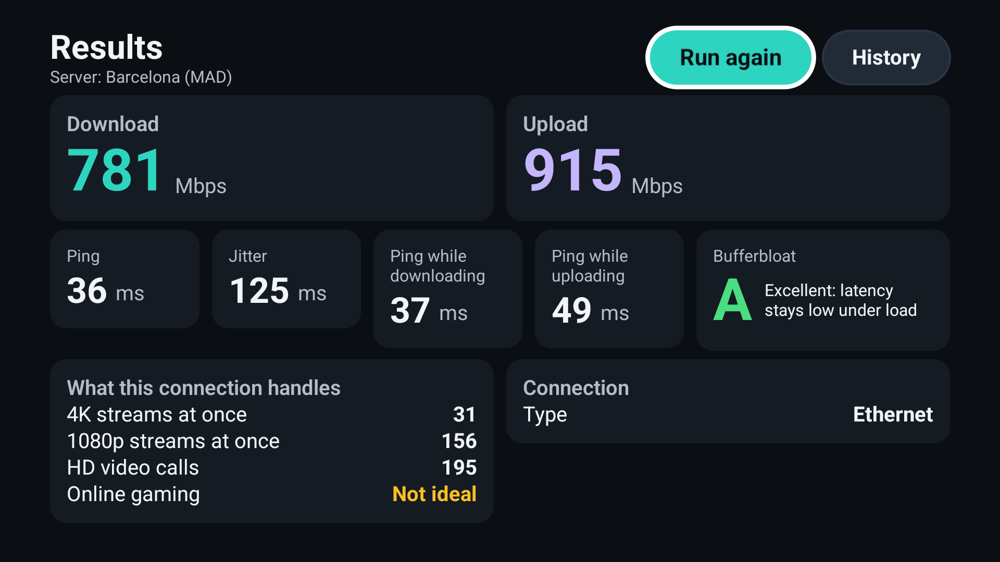

# Speedyt

**An ad-free, open-source internet speed test for Android TV and Google TV.**

Press one button and see your real download and upload speed, ping, jitter and
latency under load, measured from the TV itself, on the connection the TV
really uses.

- **Plain answers.** How many 4K streams and HD video calls the connection can
  carry at once, and whether it is good for online gaming.
- **Bufferbloat grade.** Does your connection stay responsive while something
  else is downloading? A to D.
- **Your connection, explained.** Ethernet or Wi-Fi, 2.4 / 5 / 6 GHz, signal
  strength and link speed, with tips only when they apply: switch to 5 GHz, move the
  router, or a note that many TVs have a 100 Mbps Ethernet port.
- **Made for the sofa.** Dark theme, large type, full remote control (D-pad) support.
- **History.** The last 50 results, kept on the TV.
- **English, Spanish and Russian.**
- **No ads. No accounts. No tracking.** Nothing leaves the TV except the speed-test traffic.

## Links

- [Privacy policy](privacy)
- [Source code and issues](https://github.com/zaitsew/speedyt) (MIT license)

## How it measures

Speedyt uses Cloudflare's public speed-test endpoints: 6 parallel connections
for 10 seconds each way, the first 2 seconds dropped as warm-up, and about 20
latency probes before the transfer. The details are in the
[README](https://github.com/zaitsew/speedyt#how-it-measures).
